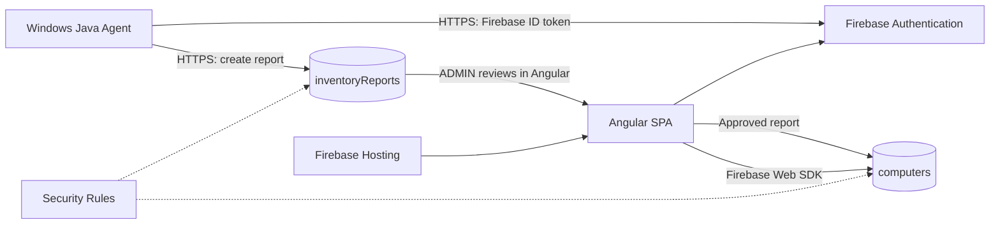

# Computer Inventory — технический дизайн MVP

**Версия:** 1.2 · 25.11.2026  
**Статус:** проект спецификации для реализации кодирующим агентом.  
**Язык интерфейса:** русский. Код, имена полей, комментарии и технические идентификаторы — английский.

## 1. Цель и границы

Создать систему инвентаризации компьютеров организации: пользователь запускает Windows-утилиту, он читает конфигурацию, заполняет местоположение и при необходимости другие учётные данные, затем регистрирует отчёт в Cloud Firestore. Администратор через веб-интерфейс просматривает, ищет, фильтрует и анализирует компьютеры, дополняет карточки организационными сведениями и экспортирует данные.

Изменения v1.2: одноэкранная форма с двумя кнопками, ручные учётные поля, GPU, карточки RAM с условным отображением скорости, отдельные строки физических дисков. Для защиты основного реестра каждый отчёт проходит ручную проверку администратором (см. §7 и §9.4).

MVP рассчитан ориентировочно на 100–1000 компьютеров и небольшое число администраторов. Это проектное допущение, не установленный лимит.

В MVP не входят Telegram, QR, PWA, собственный REST-сервер, Cloud Functions, постоянная служба Windows, автоматические задания, история изменений, отдельные справочники и управление компьютерами. Приложение не собирает содержимое файлов, пароли, историю браузера, ключи лицензий или учетные данные Windows. Сбор выполняется только на разрешённых организацией устройствах, с видимым результатом.

## 2. Архитектура



| Компонент | Решение |
|---|---|
| Agent | Java 8 (x86 runtime), Maven, OSHI + JNA, WMI, Jackson 2.x, HttpsURLConnection, Swing |
| Web | Angular, Angular Material, Firebase modular Web SDK, Chart.js, библиотека XLSX |
| Cloud | Firestore Standard Native mode, Firebase Authentication, классический Firebase Hosting |
| Тесты | JUnit 5, mock HTTP server, Firebase Emulator Suite, тесты Angular |
| Доставка | Единый InventoryAgent.exe (7-Zip SFX + JRE 8 x86); статическая сборка Angular |

Версии JRE, OSHI, JNA, Jackson, SFX и остальных зависимостей выбрать по результатам Compatibility PoC, зафиксировать версии, происхождение и контрольные суммы. Java-код агента и его runtime-зависимости должны быть совместимы с Java 8 (bytecode 52); сборочное окружение CI может использовать более новый JDK с --release 8. Для компиляции на JDK 8 использовать source/target 8 и проверку доступных API. Версии web-зависимостей закрепить в lockfile. Не использовать latest без фиксации. Spring и Firebase Admin SDK не входят в клиентские приложения. Отдельный доверенный provisioning-скрипт допустим только для управления ролями, но для MVP достаточно ручной настройки Firebase Console.

## 3. Репозиторий и модули

```text
computer-inventory/
  DESIGN.md
  README.md
  AGENTS.md
  docs/
    COMPATIBILITY.md
    DATA_MODEL.md
    SECURITY.md
    IMPLEMENTATION_PLAN.md
  agent/
    pom.xml
    packaging/      # SFX config and build scripts
    src/main/java/.../inventory/
      app/            # orchestration, entry point
      collector/      # OSHI, WMI adapters
      model/          # DTO
      normalization/  # CPU, RAM, disks, network
      identity/       # device identity
      firebase/       # Auth REST, Firestore REST, value codec
      config/         # public configuration and credentials input
      ui/             # Swing, validation and status
    src/test/
  web/
    src/app/
      core/           # auth, Firebase repository, contracts
      computers/      # list, details, filters
      reports/        # incoming reports and review
      statistics/     # aggregations and charts
      shared/
    package.json
    package-lock.json
  contracts/
    computer-report.schema.json
    computer-document.schema.json
    fixtures/
  firebase.json
  firestore.rules
  firestore.indexes.json
  tests/rules/
  .github/workflows/
    ci.yml
    release-agent.yml
    deploy-web.yml
```

Отдельные сборки agent/web. Приведённая ниже модель — базовый контракт MVP. Детальный JSON Schema утвердить после Compatibility PoC и исследования результатов коллектора, до интеграции Firebase и frontend. Общий контракт JSON Schema — источник истины для типов и тестовых фикстур. Изменения контракта выполняются одновременно с изменениями DTO, TypeScript и rules. README содержит воспроизводимые команды сборки и запуска.

## 4. Сценарии использования

**UC-01 Первичная инвентаризация.** Пользователь запускает EXE из read-only сетевой папки → нажимает «Прочитать конфигурацию» → проверяет read-only данные → вводит здание, этаж и кабинет (остальные поля при наличии) → нажимает «Зарегистрировать». Агент авторизуется и отправляет отчёт. Окно остаётся открытым с результатом. Администратор создаёт карточку компьютера, вручную приняв отчёт после проверки.

**UC-02 Повторная инвентаризация.** Повторное чтение не очищает форму. При повторной регистрации создаётся новый отчёт; при принятии обновляется тот же компьютер по стабильному deviceId, а не создаётся дубль. Обновляются технические данные и подтверждённые изменения местоположения/учётных данных. Пустые необязательные поля не стирают уже сохранённые значения.

**UC-03 Поиск и анализ.** Администратор входит в web, загружает список принятых компьютеров, ищет, фильтрует, сортирует, открывает карточку, смотрит статистику и экспортирует отфильтрованные записи.

**UC-04 Организационный учёт.** Администратор проверяет входящие отчёты, принимает или отклоняет их, редактирует ФИО, подразделение, здание, этаж, кабинет, инвентарный номер, статус и комментарий в карточке. Только явно подтверждённые изменения заменяют предыдущие организационные данные.

**UC-05 Ошибка.** Показать понятную причину при сбое чтения, валидации, авторизации, сети или записи. Сохранить введённые поля в памяти. Не заявлять об успехе до подтверждения Firestore.

## 5. Windows Agent

### 5.1 Сбор и нормализация

| Данные | Источник / правило |
|---|---|
| Hostname | имя локального компьютера, без DNS-запроса |
| Производитель и модель компьютера | OSHI / WMI Win32_ComputerSystem, при наличии достоверных данных |
| CPU | OSHI: производитель, исходное имя, модель, физические ядра, логические потоки |
| Материнская плата | OSHI: производитель, модель; серийный номер при наличии |
| Видеокарты (GPU) | OSHI / WMI Win32_VideoController: все обнаруженные адаптеры, модель, производитель, объём видеопамяти при достоверности |
| RAM | OSHI / WMI / SMBIOS: объём, тип, число занятых/свободных слотов, фактические обозначения и характеристики установленных модулей |
| Диски | физические внутренние накопители, модель, ёмкость в байтах, тип SSD/HDD/UNKNOWN, интерфейс при наличии; не считать разделы отдельными дисками |
| ОС | семейство, редакция, версия, build, архитектура |
| Сеть | WMI Win32_NetworkAdapterConfiguration и сведения об адаптере; DHCPEnabled для IPv4 |
| UUID | SMBIOS UUID, проверка формата и известных заглушек |

Использовать прямые локальные WMI-запросы через совместимую JNA/OSHI реализацию; изолировать платформенные вызовы за интерфейсом. Не зависеть от WMIC, PowerShell, Get-CimInstance или внешних утилит. Проверять доступность свойств по версии ОС; неподдерживаемое свойство не должно срывать весь запрос. Не требовать повышения привилегий; недоступные необязательные поля обозначать null и предупреждением.

CPU: удалить (R)/(TM), лишние пробелы и суффикс частоты, не удалять буквенный суффикс модели (K, F, U, G и т.п.). Сохранять cpuModelRaw. Не пытаться угадывать поколение или модель.

RAM: сумма ёмкостей установленных модулей, если полный перечень доступен; иначе общий доступный показатель с предупреждением о возможном отличии от установленного объёма. ramTotalGiB — числовая ёмкость в GiB для статистики, вычисленная из ramTotalBytes; UI явно обозначает GiB. Не округлять исходные байты. Тип MIXED при нескольких известных разных типах, UNKNOWN при недостатке данных.

**Слоты ОЗУ (обязательная функциональность MVP, best effort для конкретного ПК).** Использовать `Win32_PhysicalMemoryArray.MemoryDevices` для числа мест системной памяти (исключать несистемные массивы), `Win32_PhysicalMemory` для установленных модулей и их `DeviceLocator`, `BankLabel`, `Capacity`, `MemoryType`/`SMBIOSMemoryType`, `Speed`, `ConfiguredClockSpeed`, `Manufacturer`, `PartNumber`, `FormFactor`. Чтение дополнительных свойств зависит от версии Windows и BIOS; при необходимости исследовать доступный через OSHI/JNA SMBIOS Type 17 как источник сведений о пустых позициях. Не требовать новых native-зависимостей без PoC.

- `ramSlotsTotal` — число сообщённых мест системной памяти; `ramSlotsUsed` — число установленных модулей, если полный перечень подтверждён; `ramSlotsFree` = total - used только при непротиворечивых и известных данных, иначе null. Не считать распаянную память свободным разъёмом; если физические разъёмы неотличимы от распаянных устройств, показывать число мест по данным прошивки с предупреждением.
- `ramSlots` — единый массив сведений о модулях и известных пустых местах, без параллельного дублирования в `memoryModules`. `slotId` — реальное обозначение из источника или null; `bankLabel` — исходная метка банка или null. `occupied` — true/false/null (занят/свободен/неизвестно). Для занятого места сохранять `capacityBytes`, `memoryType`, `speedMtps`, `configuredSpeedMtps`, `manufacturer`, `partNumber`, `formFactor` при достоверном определении. Скорость в MT/s сохранять лишь при понятной семантике источника; не смешивать MHz и MT/s и не удваивать значения без основания. Для пустого/неизвестного места не приписывать модуль. Серийный номер модуля не требуется для MVP.
- Не придумывать названия пустых слотов, не сопоставлять их по порядку массива. Если известно 4 места и 2 модуля, но обозначения пустых мест неизвестны, сохранять 2 записи установленных модулей и 2 свободных по сводному счётчику. Неизвестная привязка модуля не означает, что модуль отсутствует. Если пустые места достоверно перечислены источником, включать их с occupied=false.
- `ramSlotTopology` = COMPLETE (все места идентифицированы и статусы известны), PARTIAL (частичные сведения), UNKNOWN (топология не определена). При конфликте источников не делать уверенный вывод о свободных слотах; записать предупреждение и неизвестные счётчики. Проверять дубли обозначений с учётом банка/массива, не сливать модули только по названию.
- Не собирать и не хранить предельную ёмкость памяти, не строить прогноз допустимого объёма модернизации. UI показывает доступные сведения, а не гарантирует возможность установки модуля.

GPU: обязательная функциональность сбора (best effort для атрибутов). Не ограничиваться первой видеокартой; сохранять встроенные и дискретные адаптеры, если обнаружены. Не считать значение WMI AdapterRAM достоверным для всех GPU (ограничения источника, в том числе 32-битные значения и shared memory). Не угадывать VRAM, производителя или тип GPU; при сомнении null/UNKNOWN. Не складывать выделенную и общую память. В UI для каждой видеокарты показывать модель и только достоверный объём VRAM; при неизвестном объёме не выводить его.

Диски: не выводить SSD/HDD из имени модели без достоверного источника. При отсутствии сведений использовать UNKNOWN. Ёмкость дисков в десятичных GB = bytes / 1e9 для отображения. hasSsd = true при известном SSD; false только когда все типы известны и SSD нет; иначе null.

Сеть: учитывать активные физические адаптеры, исключать loopback, VPN, виртуальные и отключенные по доступным признакам. Если тип не определён, не выдавать его за физический без предупреждения. Для DHCP не сохранять текущий IP, MAC не нужен для MVP. Для STATIC сохранять валидные IPv4 без loopback/APIPA. При нескольких адаптерах networkMode = MIXED, если есть DHCP и STATIC; UNKNOWN при неопределённости, если MIXED не доказан. staticIpv4 — массив уникальных статических адресов, пустой при DHCP. Не собирать внешний IP, шлюзы и DNS.

### 5.2 Идентификация

Основной deviceId = `smbios-` + нормализованный UUID в нижнем регистре. Исключать нулевые, FF и известные заглушки. Резервный вариант — случайный UUID, сохранённый локально в `%LOCALAPPDATA%/ComputerInventory/device-id` (доступ без прав администратора). Если основной UUID недоступен, явно сообщить о fallback; он может различаться между профилями Windows и после переустановки. Не переключать существующий локально закреплённый идентификатор автоматически. Хранить выбранный ID локально атомарно; не копировать файл идентификатора в образ установки. Проверить SMBIOS UUID на пилотной группе, особенно клонированных/виртуальных ПК. Дубликаты аппаратных UUID — риск ошибочного объединения; при выявлении администратор назначает отдельный идентификатор и устраняет конфликт вручную. Не использовать hostname/IP как ключ.

### 5.3 Интерфейс и выполнение

**Одно окно Java Swing, Windows System Look and Feel, русский язык.** Размер по умолчанию около 820 × 700 px (ориентир, уточнить после тестов DPI), изменяемый размер, поддержка экрана 1024 × 768. Без меню, вкладок, мастеров, тяжёлых UI-библиотек и дополнительных основных кнопок. Системная кнопка закрытия окна остаётся доступной. Два визуальных блока: «Конфигурация компьютера» (read-only) и «Учётные данные» (editable), ниже две кнопки и строка состояния. Прокрутка длинного блока оборудования, учётные данные и кнопки остаются видимыми при обычном размере; на малом экране обеспечить прокрутку без обрезания элементов. Tab/Shift+Tab, видимый фокус, подписи полей, перенос длинных моделей, копирование read-only текста. Не показывать секреты.

#### 5.3.1 Макет (пример, не пиксельная спецификация)

```text
┌─ Computer Inventory — Регистрация компьютера ───────────────────┐
│ Конфигурация компьютера                         [read-only]      │
│ Имя компьютера        OFFICE-PC-012                              │
│ ОС                    Windows 10 Pro x64                         │
│ Процессор             Intel Core i5-10400 (6 ядер / 12 потоков)   │
│ Материнская плата     ASUS PRIME B460M-A                         │
│ Видеокарты            Intel UHD Graphics 630                     │
│                       NVIDIA GeForce GTX 1650 — 4 GiB            │
│ Оперативная память    16 GiB DDR4                                 │
│ Сеть                  Статический IP: 192.168.1.105              │
│ Слоты ОЗУ                         Занято 2 из 4                  │
│ ┌───────────┐ ┌───────────┐ ┌───────────┐ ┌───────────┐          │
│ │ DIMM A1   │ │ DIMM A2   │ │ DIMM B1   │ │ DIMM B2   │          │
│ │ [пустой]  │ │ [модуль]  │ │ [пустой]  │ │ [модуль]  │          │
│ │ Свободен  │ │ 8 GiB DDR4│ │ Свободен  │ │ 8 GiB DDR4│          │
│ │           │ │ 2666 MT/s │ │           │ │           │          │
│ └───────────┘ └───────────┘ └───────────┘ └───────────┘          │
│ Физические накопители                           2 устройства    │
│ [SSD] Samsung SSD 870 EVO              SSD · SATA       500 GB   │
│ [HDD] Western Digital WD10EZEX          HDD · SATA         1 TB   │
├─ Учётные данные ────────────────────────────────────────────────┤
│ Инвентарный номер    [000125                                  ] │
│ ФИО сотрудника       [                                        ] │
│ Подразделение        [                                        ] │
│ Здание / корпус *    [                                        ] │
│ Этаж *               [2       ]  Кабинет * [205               ] │
│ Примечание           [                                        ] │
│                      [                                        ] │
│                      [________________________________________] │
│ * Обязательные поля                                             │
│ [ Прочитать конфигурацию ]          [ Зарегистрировать ]        │
│ ✓ Конфигурация прочитана. Готово к регистрации.                  │
└─────────────────────────────────────────────────────────────────┘
```

Макет демонстрирует COMPLETE-топологию RAM; у DIMM B2 скорость не прочитана и строки скорости нет. Это синтетический пример, не показания реального компьютера. Сведения о производителе/модели компьютера, если доступны, также включаются в read-only блок; UUID и служебные метаданные показывать необязательно.

#### 5.3.2 Представление оборудования

- RAM: карточки известных физических слотов, с фактическим обозначением, условным рисунком модуля/пустого места, статусом, объёмом и типом, производителем при наличии. Занятый слот визуально выделить зелёным, свободный — нейтральным серым; состояние различимо также по тексту, не только по цвету. Скорость выводить только если достоверно прочитана и известна единица. Предпочтительно настроенная скорость, иначе номинальная с пояснением; MT/s для скорости передачи DDR, MHz только для достоверной тактовой частоты. Если скорость недоступна, не выводить строку, нули, прочерки, Unknown или пустой label. Не рисовать вымышленные позиции для PARTIAL/UNKNOWN: показывать известные модули и отдельную сводку свободных/неизвестных мест. Число слотов произвольное; карточки переносятся/прокручиваются.
- Диски: отдельная строка/компактная карточка на каждый физический диск (не раздел), иконка SSD/HDD либо нейтральная при UNKNOWN, полная модель, тип, интерфейс (если известен), объём. Любое количество в пределах контракта, перенос длинных моделей. Не отображать неизвестный интерфейс, не подменять UNKNOWN на HDD. Десятичные GB/TB для дисков.
- GPU: отдельная строка на каждый обнаруженный адаптер, модель, VRAM только при достоверном значении. Не показывать ложный ноль при неизвестном VRAM. Если список недоступен, показать понятное предупреждение.
- Иконки и карточки реализовать простыми Swing/Java2D-компонентами либо встроенными небольшими ресурсами. Не требуется дополнительный UI-фреймворк.

#### 5.3.3 Учётные поля и валидация

| Поле | Компонент | Обязательное |
|---|---|---|
| Инвентарный номер | JTextField, строка, сохранять ведущие нули | Нет |
| ФИО сотрудника | JTextField | Нет |
| Подразделение | JTextField | Нет |
| Здание / корпус | JTextField | Да |
| Этаж | JTextField | Да |
| Кабинет | JTextField | Да |
| Примечание | JTextArea в JScrollPane, 3 строки по умолчанию, перенос слов, до 2000 символов | Нет |

Этаж и кабинет — строки, не числа: поддерживать «Цоколь», «2А», «205/1», «Серверная». Пробельная строка считается пустой. Здание обязательно во всех отчётах и карточках. Сейчас офисы находятся в двух зданиях. Название или адрес здания вводится строкой, чтобы новые здания можно было добавить без изменения схемы. При повторной отправке пустые необязательные поля означают «не изменять» существующие сведения; намеренная очистка возможна только через web администратором. Сборщик не редактирует статус и служебные поля.

#### 5.3.4 Поведение и состояния

- При открытии окно ожидает ручного чтения, «Зарегистрировать» недоступна. Не отправлять автоматически и не читать базу.
- «Прочитать конфигурацию» запускает сбор в SwingWorker; заполняет read-only поля, не сбрасывая пользовательский ввод. При ошибке обязательного коллектора регистрацию блокировать до успешного чтения. Неполнота необязательных атрибутов — предупреждение, не причина запретить регистрацию.
- «Зарегистрировать» доступна только после успешного чтения и заполнения обязательного местоположения. Повторно проверить данные при нажатии, зафиксировать snapshot формы, авторизоваться и отправить отчёт. Пока операция выполняется, обе кнопки заблокированы; при отправке поля формы также не редактируются. Не блокировать EDT, показывать ход операции текстом/индикатором.
- Строка состояния: ожидание → чтение → готовность (возможны предупреждения) → отправка → результат. При ошибке дать понятное описание, сохранить значения в памяти и позволить повторить соответствующей из двух кнопок. При неизвестном исходе «Не удалось подтвердить сохранение»; повтор той же отправки использует тот же reportId.
- При подтверждённой записи входящего отчёта: «ОК. Отчёт успешно отправлен». Не заявлять, что компьютер уже принят в основную базу. Рядом с кнопкой или в пояснении явно указать, что отчёт поступает на проверку администратору. После успешной отправки повторное нажатие без нового чтения/изменения формы не создаёт новый отчёт. Не закрывать окно автоматически.
- Ввод credentials, если нужен, реализовать в компактном inline-блоке только для авторизованного оператора, без третьей основной кнопки; не требовать пароля администратора. Окончательная модель выдачи credentials не утверждена (§7, §13). Режим --silent отложен: обязательное местоположение и ручное подтверждение являются частью MVP. Не реализовывать фоновые отправки. Exit codes для интерактивного launcher — по возможности после PoC: 0 подтверждённая запись, 1 сбор/валидация, 2 авторизация/права, 3 сеть/запись, 4 конфигурация, отдельный ненулевой код отмены без записи.

### 5.4 Совместимость и распространение

Минимальная ОС — Windows 7 SP1. Целевые платформы: Windows 7 SP1, 8/8.1 и 10 x86/x64, Windows 11 x64. Windows XP, Vista и ARM — вне MVP. Это целевая матрица, а не подтверждённая совместимость. Один Java 8 x86 runtime для всех целевых платформ, включая WOW64 на x64. Проверить корректность получения полного объёма физической памяти и архитектуры ОС из 32-битного процесса. Выбирать конкретную сборку JRE с проверенной совместимостью, лицензией на распространение и актуальными исправлениями/CA насколько возможно; не считать наличие Java 8 гарантией поддержки Windows 7.

Единственный распространяемый файл: `InventoryAgent.exe`. Установить на файловом сервере в read-only для пользователей сетевой папке (например, `\\SERVER\Software\Inventory\InventoryAgent.exe`). Никаких отдельных JRE/JAR/config рядом с EXE. Не нужны установленная Java, PATH, JAVA_HOME, инсталлятор, права администратора или регистрация службы. В EXE допустимо включить только публичную конфигурацию Firebase и несекретные настройки.

Предпочтительный механизм — совместимый x86 7-Zip SFX installer module из доверенного источника: архив содержит fat JAR, JRE 8 x86, публичную конфигурацию и лицензии. При запуске распаковать в уникальный локальный временный каталог пользователя, запустить bundled java/javaw по явному пути, дождаться завершения приложения и очистить временные файлы после штатного выхода. Не искать исполняемые файлы через сетевой рабочий каталог или PATH. Не писать в UNC-каталог; локальные логи/резервный идентификатор допустимы только в согласованных пользовательских каталогах. При сбое очистки сообщить об остатках без удаления чужих каталогов. Проверить пробелы/кириллицу в путях, параллельные запуски, недостаток места, права на TEMP, ошибки запуска и отображение результата. При обновлении публиковать проверенный артефакт только оператором с правом записи; предусмотреть замену после завершения запущенных экземпляров и откат.

Launch4j/jpackage не являются обязательными. Если выбранный SFX не проходит PoC, предложить альтернативный single-file launcher с теми же гарантиями; не переходить молча на ZIP или несколько EXE. Подписание артефакта желательно; проверить корпоративный антивирус, AppLocker/политики запуска из сети и TEMP. Не отключать защиту. CI формирует один EXE, SHA-256, список версий/лицензий; проверка реальной Windows обязательна. Сквозные exit codes проверяются отдельно, если SFX позволяет их передать. Silent-режим вне MVP; интерактивный режим обязателен.

Windows 7/8.1 и некоторые выпуски Windows 10 сняты с поддержки. Не ослаблять TLS и не подключать изолированные ПК к интернету специально для инвентаризации. Использовать только разрешённую корпоративную сеть. При отсутствии безопасного доступа показывать ошибку; отдельный офлайн-импорт — только после согласования расширения MVP.

## 6. Firebase: модель данных

Действующие схемы и правила проверки описаны в [контракте данных v1](docs/DATA_MODEL.md).

Коллекция `computers/{deviceId}` — один принятый документ на компьютер. Коллекция `inventoryReports/{reportId}` — входящие неизменяемые сборщиком отчёты (см. §7). Коллекция `users/{uid}` — назначенные администратором роли; управление через Firebase Console, не через публичное приложение.

Типы JSON ниже логические. Timestamp передаётся как Firestore Timestamp, не строка. Числа ёмкости — целые байты; поля статистики числовые. Nullable поля обязательны в полном техническом отчёте, null = неизвестно, [] = достоверно пустой список либо недоступный перечень с предупреждением. Местоположение обязательно в новых отчётах и принятых карточках; исторические тестовые документы без местоположения явно помечаются как неполные. Остальные организационные поля необязательны. Пример:

```json
{
  "deviceId": "smbios-4c4c4544-0038-1234-5678-123456789abc",
  "identitySource": "SMBIOS",
  "hostname": "OFFICE-PC-012",
  "cpuManufacturer": "Intel",
  "cpuModel": "Intel Core i5-10400",
  "cpuModelRaw": "Intel(R) Core(TM) i5-10400 CPU @ 2.90GHz",
  "cpuCores": 6,
  "cpuThreads": 12,
  "motherboardManufacturer": "ASUS",
  "motherboardModel": "PRIME B460M-A",
  "motherboardSerial": null,
  "computerManufacturer": null,
  "computerModel": null,
  "gpuModels": ["Intel UHD Graphics 630", "NVIDIA GeForce GTX 1650"],
  "gpus": [
    {"model": "Intel UHD Graphics 630", "manufacturer": "Intel", "vramBytes": null},
    {"model": "NVIDIA GeForce GTX 1650", "manufacturer": "NVIDIA", "vramBytes": 4294967296}
  ],
  "ramTotalBytes": 17179869184,
  "ramTotalGiB": 16,
  "ramType": "DDR4",
  "ramSlotsTotal": 4,
  "ramSlotsUsed": 2,
  "ramSlotsFree": 2,
  "ramSlotTopology": "PARTIAL",
  "ramSlots": [
    {"slotId": "DIMM_A2", "bankLabel": null, "occupied": true, "capacityBytes": 8589934592, "memoryType": "DDR4", "speedMtps": 3200, "configuredSpeedMtps": 2666, "manufacturer": "Kingston", "partNumber": "KF432C16BB/8", "formFactor": "DIMM"},
    {"slotId": "DIMM_B2", "bankLabel": null, "occupied": true, "capacityBytes": 8589934592, "memoryType": "DDR4", "speedMtps": null, "configuredSpeedMtps": null, "manufacturer": "Kingston", "partNumber": "KF432C16BB/8", "formFactor": "DIMM"}
  ],
  "storageTotalBytes": 1500000000000,
  "hasSsd": true,
  "disks": [
    {"model": "Samsung SSD", "type": "SSD", "capacityBytes": 500000000000, "interface": "SATA"},
    {"model": "WD Blue", "type": "HDD", "capacityBytes": 1000000000000, "interface": "SATA"}
  ],
  "osName": "Windows 11 Pro",
  "osVersion": "24H2",
  "osBuild": "26100",
  "osArchitecture": "x64",
  "networkMode": "STATIC",
  "staticIpv4": ["192.168.1.105"],
  "networks": [{"name": "Ethernet", "mode": "STATIC", "staticIpv4": ["192.168.1.105"]}],
  "warnings": ["RAM_FREE_SLOT_LABELS_UNKNOWN"],
  "schemaVersion": 1,
  "agentVersion": "1.0.0",
  "employeeName": "",
  "department": "",
  "building": "Корпус А",
  "floor": "2",
  "room": "205",
  "inventoryNumber": "",
  "comment": "",
  "status": "ACTIVE"
}
```

Дополнительные поля принятой карточки: `lastInventoryAt` (серверный `submittedAt` принятого отчёта), `lastReportId`, `assignmentUpdatedAt`, `assignmentUpdatedBy` (UID администратора). Статус ACTIVE/RETIRED; отсутствие трактовать как ACTIVE. `gpuModels` — нормализованный массив моделей для поиска/фильтрации, производный от `gpus`, не редактируется независимо. `department`, `building`, `floor`, `room`, `employeeName`, `inventoryNumber`, `comment` — строки; обязательные building, floor и room должны содержать непустые значения. Удаление компьютеров в MVP не реализуется, используется RETIRED.

Входящий отчёт: `reportId` (UUID, совпадает с ID документа), `deviceId`, `hardware` (полный технический DTO, включая identitySource, hostname, schemaVersion, agentVersion и плоские поля из примера), `assignment` (учётные поля без status; пустые необязательные поля опускаются), `submittedAt` (REQUEST_TIME), `submittedBy` (UID сборщика), `status` = PENDING. Не включать admin-метаданные в create. При обработке ADMIN добавляет `reviewedAt`, `reviewedBy`, меняет status на ACCEPTED/REJECTED; исходный payload неизменен. Принятая карточка остаётся плоской для аналитики. JSON Schema отчёта и документа — разные контракты; окончательные поля после PoC. Отчёты не являются историей изменений оборудования; это очередь регистрации, с согласованным сроком хранения и очисткой доверенным оператором.

Обязательные для успешного сбора: deviceId, identitySource, hostname, schemaVersion, agentVersion. Все прочие технические поля входят в отчет; недоступные сведения null с предупреждением. Если CPU, RAM, диски или сеть не удалось собрать вообще, не отправлять неполный отчёт, который затрёт ранее известные данные; показать ошибку и предложить повторить. Частичная недоступность отдельных атрибутов допускается и отображается в warnings.

Контракт: запрет неизвестных полей, проверка enum, положительных ёмкостей и диапазонов, ограничение строк (hostname 255, модели 256, учётные строки 256, этаж/кабинет 64, комментарий 2000), массивов (слоты/модули RAM 64, диски 64, GPU 16, адаптеры 64, предупреждения 64), общий целевой лимит отчёта 64 KiB. Никаких произвольных ключей из внешнего источника. Для RAM проверять неотрицательные целые счётчики или null, used <= total и free = total - used при известных непротиворечивых счётчиках, допустимые состояния ramSlotTopology и типы вложенных полей. Длина ramSlots не обязана равняться ramSlotsTotal; при COMPLETE должна соответствовать полному перечню с известными состояниями. При PARTIAL допускаются анонимные свободные места только в сводном счётчике. Пример выше демонстрирует именно частичную топологию. Согласовать точные nullable-поля, коды warnings и правила источников в DATA_MODEL.md по итогам коллектора. Не индексировать подробные массивы и длинные комментарии, если по ним нет запросов. Индексировать только поля будущих серверных фильтров; в MVP достаточно стандартных индексов и клиентской фильтрации.

## 7. Авторизация и безопасность

Этот раздел описывает проверенные правила этапа Firebase Emulator. Расширение прав для веб-интерфейса согласовано в [плане веб-интерфейса](docs/WEB_DESIGN.md). Оно требует обновления контракта и правил.

### 7.1 Модель доступа

Firebase Authentication: email/password. Учетные записи создаёт администратор. Роль определяется по `users/{uid}` с `role` (COLLECTOR или ADMIN) и `enabled` (boolean). Сам факт входа не даёт доступа. Клиентам запрещено изменять роли; собственный документ роли доступен владельцу на чтение, list запрещён.

**Утверждённая модель приёма.** Сборщик создаёт отчёт со статусом `PENDING`. Администратор вручную проверяет каждый отчёт во фронтенде. Только явное принятие создаёт или обновляет карточку в `computers`. Отклонение закрывает отчёт без изменения карточки.

| Операция | Без роли / disabled | COLLECTOR | ADMIN |
|---|---|---|---|
| Создание PENDING отчёта | Нет | Да, при открытом приёме | Нет (MVP) |
| Чтение/list отчётов | Нет | Нет | Да |
| Изменение/удаление payload отчёта | Нет | Нет | Нет |
| Принятие/отклонение отчёта | Нет | Нет | Да |
| Чтение списка/карточек компьютеров | Нет | Нет | Да |
| Создание/обновление технических полей компьютера | Нет | Нет | При принятии отчёта |
| Изменение организационных полей компьютера | Нет | Нет | Да |
| Удаление компьютеров или изменение ролей | Нет | Нет | Нет |
| Управление приёмом отчётов | Нет | Нет | Да |

`settings/inventory.acceptingReports` (boolean) проверяется rules на каждой отправке; закрытый/отсутствующий документ запрещает создание. ADMIN может переключать только этот параметр, документы ролей меняются через Firebase Console. Отключение COLLECTOR (enabled=false) и закрытие приёма действуют на новые запросы, включая запросы с ранее выданным токеном.

**Credentials:** постоянный пароль или service-account JSON не включать в EXE. Public projectId/apiKey допустимы внутри артефакта. Базовый безопасный вариант разработки — отдельная временная ограниченная учётная запись сборщика, секрет вводит уполномоченный оператор при отправке; не вводить пароль администратора на обследуемом ПК. Требование полностью автоматического входа остаётся открытым: до production владелец согласует внешний защищённый способ выдачи секрета либо явно принимает остаточный риск временных общих credentials. Встраивание даже временного пароля не обеспечивает конфиденциальность и не утверждено. Не сохранять пароль, ID/refresh token в Git, логах, на диске или в аргументах CLI. Токены только в памяти. Не использовать Firebase Admin SDK на клиенте.

Общий COLLECTOR не доказывает принадлежность отчёта конкретному ПК: возможны ложные отчёты и расход квот. Ручная проверка, ограничение прав, закрытие приёма, отключение роли и смена пароля/отзыв сессий уменьшают риск, но не устраняют его. Не принимать отчёты автоматически. При неприемлемости риска остановить production и согласовать другую архитектуру.

### 7.2 Security Rules — обязательная спецификация модели приёма

Deny by default. Проверять `users/{uid}.role`, enabled и, для create отчёта, `settings/inventory.acceptingReports`. COLLECTOR может только создать `inventoryReports/{reportId}`: точный перечень полей, reportId совпадает с ID, submittedBy == request.auth.uid, submittedAt == request.time, status=PENDING, обязательные assignment.building, assignment.floor и assignment.room содержат непустые значения, status компьютера и поля review отсутствуют. Отдельно запретить get/list/update/delete. ADMIN может читать отчёты и менять только status и review-метаданные, переход только PENDING → ACCEPTED/REJECTED, reviewedAt == request.time, reviewedBy == request.auth.uid. Исходные hardware/assignment/deviceId/submit-поля неизменяемы.

ADMIN принимает отчёт транзакцией Firestore (см. §9.4); `computers` create/update технических полей разрешён только в рамках принятия соответствующего PENDING отчёта. Спроектировать и протестировать междокументные проверки `get`/`getAfter`: согласованный deviceId, lastReportId, lastInventoryAt, переход статуса, соответствие технических полей исходному отчёту, неизменность идентичности. Для независимой правки карточки разрешены лишь организационные поля, status и assignmentUpdatedAt/By; timestamp == request.time, UID совпадает. Не разрешать потерю обязательных полей. Точную реализуемость правил и лимиты document access calls подтвердить Emulator Suite до интеграции; если строгая связь недостижима, не ослаблять правила молча, документировать блокер и согласовать решение.

Проверять типы, ограничения строк/массивов, enum, скалярные диапазоны и allowlist полей. Rules не являются полноценным JSON Schema валидатором произвольных массивов и не гарантируют достоверность hardware. Java валидирует отчёт, Angular повторно валидирует перед принятием и при чтении; зафиксировать ограничения в SECURITY.md. Не доверять роли из localStorage или из payload. Не отображать входные строки как HTML.

TLS 1.2+ с проверкой цепочки сертификатов и hostname; проверить публичные endpoint на Windows 7 SP1 и выбранном JRE. Не отключать TLS-проверки, не отправлять данные на другие адреса. Логи локальные, без ФИО, комментариев, полных payload, паролей и токенов. Отключить незапланированную телеметрию.

## 8. Протокол Java → Firebase

Java 8 HttpsURLConnection, UTF-8, таймауты. Public config: projectId, apiKey, databaseId=(default). Dev endpoints Emulator Suite отделены от production. Java 11 HttpClient не использовать.

1. После нажатия «Зарегистрировать» собрать snapshot технических/учётных данных, валидировать, сгенерировать UUID reportId. Для повтора той же отправки сохранить ID и неизменный snapshot в памяти.
2. POST `https://identitytoolkit.googleapis.com/v1/accounts:signInWithPassword?key={apiKey}` с email/password/returnSecureToken=true. Использовать ID token и localId (UID для submittedBy) в памяти, не логировать запрос/ответ с credentials.
3. POST `https://firestore.googleapis.com/v1/projects/{projectId}/databases/(default)/documents:commit` с `Authorization: Bearer {idToken}`, Content-Type application/json.
4. Одна Write: update с document name `projects/{projectId}/databases/(default)/documents/inventoryReports/{reportId}`, typed Firestore fields (`stringValue`, `integerValue` со строкой числа, `arrayValue`, `mapValue`, `nullValue` и т.д.), `currentDocument.exists=false` и updateTransforms для `submittedAt=REQUEST_TIME`. Нет предварительного GET, collector не имеет read-доступа. Не писать в `computers`.
5. Успех — 2xx и корректный CommitResponse. При таймауте исход может быть неопределён. Повтор того же reportId не создаёт дубль; отказ precondition/permission после неопределённого исхода не доказывает, что отчёт сохранился. Показать «Не удалось подтвердить сохранение», reportId для проверки администратором, не выдавать ложный OK. Новый осознанный отчёт имеет новый UUID. После успешного сохранения вывести «ОК. Отчёт успешно отправлен».

Таймаут подключения 5 секунд, чтения 15 секунд, общий deadline; максимум 3 попытки записи с задержками 1/2 секунды и небольшим jitter. Повторять только временные сетевые ошибки и 408/429/500/502/503/504 с учётом Retry-After в пределах бюджета. 401 — максимум одна повторная авторизация при наличии credentials; 403/400 и постоянные ошибки не повторять. Не сохранять очередь отчётов на диск в MVP. Не выводить сырые сообщения серверов в UI. При отмене не запускать новые попытки.

## 9. Web: функциональный дизайн

[План веб-интерфейса](docs/WEB_DESIGN.md) определяет согласованные права администратора и пользователя, в том числе исправление отчётов, работу с архивом и доступ к выгрузкам. Новые права будут проверены в эмуляторе перед подключением.

Angular SPA на Firebase Hosting, маршруты `/login`, `/computers`, `/computers/:deviceId`, `/statistics`, `/reports`, `/settings`. Route guards для UX; безопасность обеспечивают rules, не guards. Firebase Web SDK, сессия авторизованного администратора, кнопка выхода. Не включать постоянный offline-cache корпоративных данных в MVP. Показать загрузку, пустое состояние, ошибку доступа/сети и кнопку обновления. Не показывать старый список как актуальный после ошибки обновления.

### 9.1 Таблица компьютеров

Колонки: hostname, CPU model, RAM GiB, занято/всего слотов, motherboard, GPU, накопители (тип/объём), OS, сеть/IP, ФИО, подразделение, здание, этаж, кабинет, инвентарный номер, статус, последнее сканирование. По умолчанию ACTIVE, сортировка hostname, 25/50/100 строк на страницу; настройки только локально без персональных данных. Колонки можно скрывать. Desktop-first, адаптивность без обязательной PWA.

Поиск без учёта регистра по hostname, CPU, GPU, ФИО, подразделению, статическим IP, кабинету и инвентарному номеру. Фильтры: CPU manufacturer/model, GPU model, RAM volume/range/type, число свободных слотов и наличие свободных (да/нет/неизвестно), SSD yes/no/unknown, OS, STATIC/DHCP/MIXED/UNKNOWN, location, status, дата последней инвентаризации. Фильтры совместимы между собой (AND между категориями, OR внутри множественного выбора). Сортировать числовые значения численно, неизвестные в конце. Кнопки сброса фильтров и экспорта.

### 9.2 Карточка компьютера

Техническая информация read-only; показать все диски, GPU, RAM slots и сетевые адаптеры, исходное имя CPU и предупреждения сбора. Блок RAM: общий объём, тип, всего/занято/свободно, таблица фактических обозначений и характеристик каждого установленного модуля, известных пустых мест; при PARTIAL/UNKNOWN показать неизвестную привязку и число свободных мест без вымышленных меток. Не отображать предел поддерживаемой ёмкости. Условная схема слотов допустима только при достоверной топологии; для MVP достаточно таблицы. Организационные поля редактируемы: employeeName, department, building, floor (строка), room (строка), inventoryNumber (строка с сохранением ведущих нулей), comment (textarea), status. Местоположение валидируется как в агенте. Скорость RAM и VRAM показывать только при достоверном значении, аналогично агенту. Сохранять только изменённые организационные поля и серверные метаданные. Отмена не записывает ничего. Обработать конкурентное редактирование через транзакцию с проверкой версии assignmentUpdatedAt либо явное предупреждение о конфликте. Успех только после подтверждения SDK. Удаления нет.

### 9.3 Статистика

Один снимок данных из Firestore для таблицы и графиков. Для MVP загрузка по требованию, без постоянных snapshot listeners. На клиенте вычислять группировки и count. Не создавать коллекцию статистики и не дублировать документы CPU/RAM. Явно показывать область расчёта (все активные ПК или выбранные фильтры), число неизвестных значений и количество учтённых ПК.

Обязательные графики: распределение по cpuModel и ramTotalGiB, производитель CPU, тип RAM и наличие свободных слотов (есть / нет / неизвестно), SSD/HDD/UNKNOWN, Windows version, режим сети. KPI: всего активных, RAM менее 8 GiB, RAM менее 8 GiB со свободными слотами (только подтверждённые), с SSD, без SSD, неизвестный тип накопителя. Не считать неизвестное значение нулём. CPU model grouping использует нормализованное имя; RAM grouping использует число, а не форматированную строку. Нажатие на группу может открывать таблицу с соответствующим фильтром (желательно, не блокирует MVP).

Экспорт XLSX: текущий отфильтрованный список, отдельные колонки, в том числе всего/занято/свободно слотов RAM, явные единицы измерения, даты и числовые типы, идентификаторы как строки. Внешний ввод не трактовать как формулы; тестировать строки с =, +, -, @. Экспорт доступен только ADMIN. Не отправлять файл во внешние сервисы.

### 9.4 Входящие отчёты и управление приёмом

Список PENDING отчётов, поиск по hostname/deviceId, дата отправки, местоположение, краткая конфигурация. Карточка сравнения с текущим компьютером; показать изменённые технические и организационные поля, неизвестные значения, предупреждения и конфликты идентификации. ADMIN явно принимает или отклоняет. Никакого автоматического импорта. При первом принятии создать ACTIVE компьютер; при повторном — обновить по deviceId, не менять существующий status, не стирать отсутствующие/пустые необязательные учётные поля. Явно подтвердить изменение местоположения и прочих непустых учётных полей. Старый отчёт (submittedAt раньше последней принятой инвентаризации) не может молча перезаписать свежие данные: показать конфликт и предложить отклонить. При совпадении timestamps применять детерминированный порядок или явно разрешать конфликт. Не принимать отчёт с неподдерживаемой схемой, конфликтом identity или недостоверными обязательными данными.

Одна транзакция читает PENDING отчёт и текущую карточку, валидирует данные, записывает технические и выбранные организационные поля компьютера и переводит отчёт в ACCEPTED. Проверять исходную версию документа после повторного запуска транзакции; если оператору показаны устаревшие изменения, запросить повторное подтверждение. Отклонение меняет только статус отчёта и review-метаданные. Повторное принятие исключено. Не менять RETIRED на ACTIVE автоматически. Настройки: один переключатель «Приём отчётов», доступный ADMIN. Основная статистика и экспорт берут только принятые карточки; PENDING не учитываются. При закрытом приёме агент показывает понятную ошибку. Политика хранения обработанных отчётов и удаления доверенным оператором подлежит согласованию; не считать очередь долговременной историей.

## 10. Эксплуатация Firebase

Начать со Spark при условии достаточности квот. Проверить актуальные ограничения перед развёртыванием: стандартная бесплатная квота Firestore включает 50 000 чтений, 20 000 записей и 20 000 удалений в сутки, 1 GiB хранения; отдельно учитываются Hosting, Auth и трафик. Вызовы rules для проверки роли могут добавлять чтения. Одна загрузка 1000 документов не равна одному чтению. Не обещать нулевую стоимость без расчёта; не подключать Blaze автоматически. Использовать классический Hosting, не App Hosting.

Раздельные dev и prod проекты. Выбрать регион БД после согласования требований к расположению данных. Запретить test-mode rules. Проверить доступность Firebase из реальной корпоративной сети (DNS, TLS, proxy, firewall). Запланировать ручное резервное копирование через административный экспорт структурированных данных JSON (computers, inventoryReports и настройки; роли отдельно доверенным оператором) в защищённое место; XLSX — отчёт, не полноценный backup. Официальный managed export/backup может требовать платного тарифа; не включать его без согласования. До эксплуатации проверить восстановление тестовых данных доверенным оператором.

Развёртывание: firebase.json со SPA rewrite на index.html, настройки Hosting, rules, indexes. Только проверенные сборки и правила. README: создание проекта, включение email/password, создание пользователей и ролей, конфигурация agent/web, запуск emulator, сборка единого EXE и публикация в read-only UNC, deploy, отзыв доступа. Не публиковать production-секреты. CI production deployment только с явным подтверждением и минимальными правами.

## 11. План реализации для кодирующего агента

| Этап | Задачи | Результат / gate |
|---|---|---|
| 0. Bootstrap + Compatibility PoC | Структура, AGENTS.md, README, CI; Java 8 x86, OSHI/JNA/WMI, Swing, пробный single EXE и HTTPS к dev Firebase на целевых ОС | Зафиксированы версии и результаты в COMPATIBILITY.md; выпуск заблокирован при несовместимости |
| 1. Collector + исследование | Локальный сбор CPU/RAM (включая слоты), GPU, дисков, сети, identity; тестовые отчёты разных ПК без production-данных | Проверены свойства и ограничения источников, особенно Windows 7 и RAM; согласованы неизвестные значения |
| 2. Data Contract | DATA_MODEL.md, JSON Schema, Java DTO, TS types, фикстуры, правила нормализации | Схема утверждена до Firebase/Web, общие fixture-тесты проходят |
| 3. Firebase dev | Emulator, users/computers/inventoryReports/settings, security rules, SECURITY.md, отрицательные тесты | Ни одной неразрешённой операции в пределах модели доступа |
| 4. Agent integration | Auth REST, Firestore codec/commit, retry, одноэкранный Swing, валидация формы | Отправка и повтор без дублей подтверждены emulator |
| 5. Web | Login, таблица, фильтры, карточка и слоты RAM, GPU, приём/отклонение отчётов, административное сохранение | E2E с тестовыми данными |
| 6. Analytics | CPU/RAM, статистика слотов, дополнительные графики, XLSX | Проверка группировок и экспорта |
| 7. Packaging | 7-Zip SFX + JRE 8 x86, единый EXE, CI, Hosting build | Запуск из read-only UNC на чистых целевых Windows без Java, установка не нужна |
| 8. Pilot | 5–10 разрешённых ПК разных конфигураций, тест сети, квот, прав, backup | Ручная приёмка и разрешение production |

Stage 0: отдельно проверить Windows 7 SP1 x86 и x64, Windows 8/8.1 x86/x64, Windows 10 x86/x64 и Windows 11 x64 (доступные конфигурации VM/реальных ПК). Проверить полный объём RAM на x64, WMI-источники слотов и скорости RAM, GPU и ограничения VRAM, DHCP/STATIC, Swing, TLS Auth/Firestore и запуск пробной упаковки из read-only UNC. Для HTTPS использовать тестовый проект с синтетическими данными только после разрешения владельца; emulator проверяет протокол и rules, но не подтверждает совместимость публичного TLS. Если платформа пока недоступна или не проходит тест — отметить NOT TESTED/FAIL и согласовать решение; не объявлять её поддерживаемой. Не фиксировать неподтверждённые версии как окончательные.

Этапы выполняются последовательно до утверждения контракта, после чего независимые задачи могут идти параллельно. Не начинать production deployment до gate 8. Принцип SDD: требования → задача → реализация → тесты → review → приёмка. Каждый PR содержит ссылки на требования, проверенные сценарии, список ограничений; не расширять scope без согласования. Не удалять существующие ресурсы Firebase и не менять billing без явного разрешения. IMPLEMENTATION_PLAN.md оформить перед реализацией; обновлять по итогам PoC.

## 12. Критерии приёмки и тестовая матрица

| ID | Проверка | Ожидаемый результат |
|---|---|---|
| AC-01 | Единый EXE на целевой матрице Windows 7 SP1–11 без Java | Запуск без установки/runtime извне и без повышения прав; подтверждена работа x86 на x64 |
| AC-02 | ПК с известным CPU, RAM, дисками | Значения совпадают с проверкой Windows; размеры корректны |
| AC-03 | DHCP / STATIC / MIXED | Режим корректен; динамический IP не сохранён |
| AC-04 | Недоступный атрибут | null/UNKNOWN и предупреждение, без выдуманных данных |
| AC-05 | Сбой обязательного коллектора | Нет записи неполного отчёта; понятная ошибка |
| AC-06 | Первичная отправка и принятие | Один PENDING отчёт, серверный timestamp, OK только после commit; компьютер создаётся только при принятии |
| AC-07 | Повтор и изменение hostname | После принятия тот же компьютер; пустые необязательные поля не затирают значения |
| AC-08 | Нет сети / timeout / 503 | Ограниченный retry; нет ложного OK |
| AC-09 | Неверный пароль / запрещённая роль | Ошибка, без бесконечных повторов |
| AC-10 | COLLECTOR пытается читать/list/delete | Запрещено rules |
| AC-11 | COLLECTOR пишет computers, меняет/удаляет отчёт или подделывает status/UID | Запрещено rules; учётные поля допустимы только в новом PENDING отчёте |
| AC-12 | ADMIN меняет CPU/RAM вне принятия отчёта или создаёт роль | Запрещено rules |
| AC-13 | Неизвестный UID, disabled, unauthenticated | Нет доступа к computers |
| AC-14 | Некорректный тип, лишнее поле, неверная схема, поддельный timestamp | Запрещено в пределах проверок rules; клиентская валидация покрывает вложенные DTO |
| AC-15 | Поиск, комбинированные фильтры, сортировка | Результат соответствует фикстурам |
| AC-16 | Статистика CPU/RAM | Суммы групп согласованы с количеством ПК; unknown учтён отдельно |
| AC-17 | Экспорт | Ровно выбранные строки, корректные числа, ведущие нули, нет формульной инъекции |
| AC-18 | Принятие отчёта одновременно с правкой кабинета | Нет потери правок; конфликт требует повторного подтверждения |
| AC-19 | Конфликт SMBIOS / недоступный UUID | Проверены fallback и процедура ручного разрешения |
| AC-20 | Разбор артефакта и логов | Нет паролей, токенов и ключей service account |
| AC-21 | Выход из Web / отключение роли | Новые запросы запрещены; список очищен при выходе |
| AC-22 | Backup/restore на dev | Восстановление проверено без воздействия на prod |
| AC-23 | Запуск единственного EXE из read-only UNC | Нет записи в share; уникальный TEMP, штатная очистка, понятная ошибка при сбое, результат виден пользователю |
| AC-24 | RAM: 4 места, 2 заняты, все обозначения известны | 4/2/2, реальные метки и характеристики модулей, корректная таблица |
| AC-25 | RAM: известны только 2 установленных модуля и 4 места | 4/2/2 при согласованных источниках; нет выдуманных обозначений, PARTIAL |
| AC-26 | RAM: неизвестное число мест, противоречивые данные, распаянная память, одинаковые метки | Нет ложных свободных слотов; null/предупреждение при недостоверности, установленные модули не теряются |
| AC-27 | RAM-фильтры, статистика и экспорт | Занято/всего/свободно численно, unknown отдельно, данные совпадают с фикстурами |
| AC-28 | TLS на выбранном JRE 8 и Windows 7 SP1 | Безопасная авторизация и подтверждённая тестовая запись в разрешённом dev Firebase, либо документированный блокер без отключения TLS-проверок |
| AC-29 | Windows x64 с RAM >4 GiB, агент x86 | Полный установленный объём и правильная архитектура ОС; ошибки/ограничения обнаружены PoC |
| AC-30 | Упаковка и runtime | Версии, лицензии, SHA-256, отсутствие зависимости от внешнего JRE; при наличии сквозных exit codes проверена их передача |
| AC-31 | Открытие окна и ручное чтение | Одно окно, ровно две основные кнопки, без автоматической отправки; read-only поля копируемы |
| AC-32 | Валидация места | Для регистрации нужны здание, этаж и кабинет. Поля из одних пробелов считаются пустыми |
| AC-33 | Повтор чтения и ошибка отправки | Введённые поля сохраняются, EDT не блокируется, кнопки блокируются на время операции, результат остаётся видимым |
| AC-34 | RAM с известной/неизвестной скоростью | Достоверная скорость с корректной единицей; при отсутствии строки скорости нет; нет вымышленных слотов |
| AC-35 | Один/несколько GPU и неизвестный VRAM | Отдельная строка на адаптер, неизвестный VRAM не выводится, модели сохраняются и доступны для поиска |
| AC-36 | Один/несколько дисков, UNKNOWN | Отдельные физические диски, корректные модель/тип/объём, неизвестный интерфейс скрыт; длинные значения не обрезаны |
| AC-37 | Учётные поля и примечание | JTextArea с переносом и прокруткой; ведущие нули, этаж/кабинет как строки, ограничение длины |
| AC-38 | UI на 1024 × 768, повышенный DPI | Все поля и действия доступны, оборудование прокручивается, нет наложений |
| AC-39 | Закрытие приёма/отключение роли | Новая отправка запрещена даже с ранее выданным токеном; существующая база не меняется |
| AC-40 | Принятие, отклонение и повтор принятия | Атомарная запись карточки/статуса, отклонение не меняет ПК, повтор запрещён, stale report не перезаписывает свежий |
| AC-41 | Неопределённый исход commit | Повтор использует тот же reportId, не возникает дубля, без подтверждения нет OK |

Unit: нормализация CPU, RAM bytes/GiB, нормализация слотов и неполной топологии, классификация сети, идентификатор, REST typed codec, ошибки/таймауты, агрегации и фильтры. Contract: Java JSON и TypeScript против одних fixtures. Integration: Auth/Firestore emulator, rules с ролями и всеми отрицательными сценариями, create-only commit, review transaction и masked update учётных полей. Windows manual: реальная работа OSHI/WMI на обычной учетной записи, различные адаптеры, старые ПК, RAM с 2/4 слотами, ноутбуки с распаянной памятью, неизвестные метки, x86/x64, запуск из UNC и очистка TEMP. E2E: scan → заполнение места → отправка → login ADMIN → review → accept → list → details → update → statistics → export. Не подменять реальную проверку Windows моками. CI должен запускать тесты и сборки; ручные тесты описать отдельно с результатами.

## 13. Открытые решения и риски

- Подтвердить разрешение организации на передачу ФИО, внутренних IP и характеристик в Google Cloud; определить регион, срок хранения, круг администраторов и политику удаления. До согласования использовать только синтетические данные.
- Проверить фактический парк Windows и доступ к Firebase. Минимум Windows 7 SP1, одна x86 сборка; точные версии JRE/JNA/OSHI/SFX, TLS, UNC и WOW64 — обязательный PoC. Если безопасная совместимость не достигнута, согласовать альтернативу до релиза.
- Подтвердить способ выдачи credentials сборщика без участия обычного пользователя. Постоянный пароль не встраивается. До согласования используется операторский ввод в dev; production blocked. Зафиксировать способ выдачи credentials до этапа 3.
- Согласовать срок хранения входящих отчётов.
- Проверить уникальность SMBIOS на пилоте. При массовом клонировании потребуется более надёжный идентификатор.
- Подтвердить реальное число ПК и администраторов, лимиты Spark и допустимость клиентской загрузки всей коллекции; при росте вводить пагинацию/агрегации на стороне сервера.
- Выбрать стабильные версии Angular/Material, OSHI, JNA, Jackson, JRE, SFX, SDK и библиотек после проверки совместимости. Уточнить окончательные технические поля, включая достоверность слотов и семантику скорости RAM и достоверность GPU/VRAM, по тестовым отчётам; не менять согласованные требования без причины. Это дизайн, не реализованный и не протестированный продукт.

## 14. Официальные технические ссылки

- Firebase Auth REST: https://firebase.google.com/docs/reference/rest/auth
- Firestore REST и авторизация: https://firebase.google.com/docs/firestore/use-rest-api
- Write, masks, transforms: https://firebase.google.com/docs/firestore/reference/rest/v1/Write
- Security Rules fields: https://firebase.google.com/docs/firestore/security/rules-fields
- Security checklist: https://firebase.google.com/support/guides/security-checklist
- Firestore quotas: https://firebase.google.com/docs/firestore/quotas
- Pricing: https://firebase.google.com/pricing
- Hosting: https://firebase.google.com/docs/hosting
- Emulator: https://firebase.google.com/docs/emulator-suite
- OSHI: https://github.com/oshi/oshi
- WMI PhysicalMemory: https://learn.microsoft.com/en-us/windows/win32/cimwin32prov/win32-physicalmemory
- WMI PhysicalMemoryArray: https://learn.microsoft.com/en-us/windows/win32/cimwin32prov/win32-physicalmemoryarray
- Java system requirements (не гарантия совместимости конкретного runtime): https://www.java.com/en/download/win_sysreq-sm.jsp
- 7-Zip / LZMA SDK: https://www.7-zip.org/sdk.html

## 15. Стартовая инструкция кодирующему агенту

Read DESIGN.md completely. Treat the MVP scope, data contract, security model and acceptance criteria as requirements. Inspect the repository before changing files. First produce a short implementation plan and a task list for stages 0–3. Record unresolved decisions in docs/decisions.md. Implement stage 0 (Bootstrap and Compatibility PoC) first. Do not assume Windows 7 SP1 or x86 runtime compatibility without evidence. Use a single self-contained EXE, no installation, read-only UNC deployment. After the collector study, finalize DATA_MODEL.md and shared schemas before integrating Firebase and building the web UI. RAM slot counts and available per-slot/module details are mandatory features; never invent physical slot labels or collect maximum supported memory capacity. GPU inventory is mandatory (best effort for individual attributes). Implement the single-screen Swing form with two primary buttons, read-only hardware, editable assignment, required building, floor and room, and optional remaining fields. Omit unknown RAM speed and GPU VRAM in UI. Render physical disks separately. Use the approved create-only inbox with mandatory manual review. Confirm collector credential delivery before stage 3. Work through the stages in order, with tests and review at each gate. Do not introduce a custom backend, Telegram, QR codes, paid cloud services or permanent embedded credentials. Use synthetic data and Firebase Emulator Suite until the owner approves production configuration. Do not deploy, change billing or modify existing cloud resources without explicit approval. Keep the implementation simple and avoid speculative abstractions. Report test results and limitations accurately.
